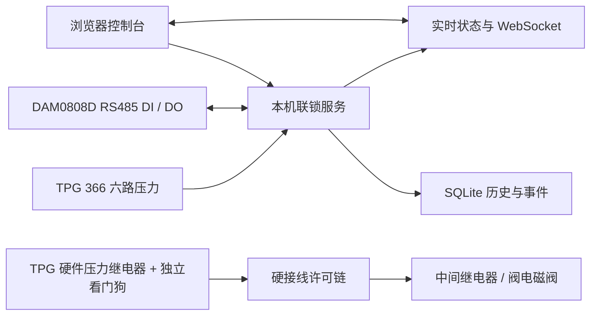

# 真空联锁控制台

用于 TPG 366 真空规控制器与 HTC GVBB-SS-CF63-P 插板阀的本地监控和联锁演示程序。提供实时压力、通道阈值、关阀/人工复位流程、SQLite 历史数据、CSV 导出和事件审计；前端采用暗色液态玻璃面板，布局参考 [beam-stabilizer-live-control](https://github.com/dcysbb/beam-stabilizer-live-control)，玻璃效果为本项目独立实现。

> **现场安全边界：** 本项目不是经过功能安全认证的安全仪表系统。软件轮询、操作系统、网络、DAM0808D 或其输出发生故障时，不能单独保证阀门关闭。真实使用前必须由有资质的人员把 TPG 366 压力继电器、独立硬件看门狗和阀门电磁阀组成断线趋于关阀的硬接线许可链，并用实际阀/线圈验证失电动作、气源故障、传感器极性和关阀时间。DAM 继电器负载与浪涌抑制须按电磁阀线圈规格核对。真实联锁默认禁用，不能把示例阈值当作设备设定值。

## 快速开始

开发和首次演示需要 Python 3.11+、Node.js 22+ 与 npm。后端默认以模拟模式运行，不会连接真实设备。

在 Windows PowerShell 从仓库目录运行：

```powershell
npm --prefix frontend ci
npm --prefix frontend run build
py -3.12 -m venv backend\.venv
backend\.venv\Scripts\python -m pip install -r backend\requirements.txt
Push-Location backend
.\.venv\Scripts\python run.py
Pop-Location
```

服务启动后访问 <http://127.0.0.1:8770>。本机浏览器打开即可操作，无需设置密码或登录；局域网访问仍使用操作员会话。模拟状态下可以启用联锁、模拟开阀、注入压力超限并验证锁存关阀和人工复位。

`py -3.12` 创建虚拟环境后，后续启动只需在仓库根目录执行：

```powershell
Push-Location backend
.\.venv\Scripts\python run.py
Pop-Location
```

macOS/Linux 开发环境可在 `backend` 中用 `python3 -m venv .venv`、`.venv/bin/python -m pip install -r requirements.txt` 和 `.venv/bin/python run.py` 启动。前端开发服务器使用 `npm --prefix frontend run dev`，端口 5173 会代理 API 和 WebSocket 到本机后端。

## 配置真实设备

界面的“复位（不启用）”只撤销开阀输出、清除故障并返回未启用，不写入 TPG 阈值、不触发硬件复位继电器、不自动启用联锁，也不把未知阀位标成关闭。实际启用联锁仍须另点“启用联锁”，通过完整硬件校验、恢复阈值与稳定时间检查。原 `/api/interlock/reset` 保留“校验后复位并启用”的接口语义；故障确认使用 `/api/interlock/clear-fault`。

左侧 Debug 菜单可手动控制 DAM0808D 的 OUT1–OUT8（软件 DO0–DO7）。本机直接确认设备可动作后，仅在联锁未启用时允许开启；关闭按钮不要求该确认。默认开启后持续保持，直到手动关闭；可选勾选“定时关闭”，设置 1–60 秒自动关闭时间，也可提前手动关闭。程序停止、解除联锁或修改配置会撤销本次 Debug 输出；存在未关闭调试输出时不能启用联锁。模拟模式显示模拟输出，真实模式读回设备线圈状态。所有切换记录到事件日志。Debug 直接动作继电器，不校验压力许可，通信/程序故障时不能保证输出关闭，仅供停机调试。

历史数据页提供“重置历史”：默认只清除模拟压力记录，真实记录与事件日志保留；也可明确选择清除全部压力记录。重置不受查询时间/通道筛选限制，本机无需登录，仍需确认，操作不可撤销，完成后重新查询图表，后台采集继续。

1. 在本机浏览器直接进入“设备与系统设置”。
2. 选择“真实设备”，填写 TPG 366 的 TCP 或 USB 参数；I/O 控制器默认选择 DAM0808D RS485，填写 USB 转 RS485 的 COM 端口、波特率和现场设备地址。默认 9600、8N1；软件设备地址默认 1，仅为占位值，必须按拨码与地址偏移核实。厂家示例地址 FE（254）也支持，广播地址 0 禁用。
   若使用 USB，连接方式选择“USB 串口”，填写设备管理器中的 COM 端口和控制器一致的波特率（默认 9600，8N1）。Windows 必须安装对应虚拟串口驱动。可点击“仅连接真空规”读取数据；没有 DAM 和保护阈值时仍可监测、保存历史，联锁保持未启用。
3. 只为确定需要保护的 TPG 通道启用保护，并填入实验室批准的关阀压力和较低的恢复压力。界面单位可选 Pa、mbar、Torr，存储值统一为 Pa。任一已启用通道达到关阀值即锁存触发；所有保护通道都低于恢复值并稳定一段时间后，才允许人工复位。
4. 按现场接线填写 DAM DI/DO 通道及有效电平。现场核对阀门传感器的数量、常开/常闭、安装位置和开/关方向；默认极性按“不许可”处理，不应在未测量输入的情况下直接切换。
5. 保存配置，点击“连接并校验”。程序连接 TPG 366 与 DAM0808D，并把启用通道的压力回差写入 TPG 继电器后逐路读回。设备离线或设定值读回不符时，不能启用联锁。
6. 完成下一节列出的硬件验收后，在真实硬件确认卡片勾选确认并输入“现场确认”，再手动启用联锁。启用前需要压力读数新鲜、阀门关闭位置有效、硬件许可和独立看门狗反馈均正常。

### 设备映射

DAM 与 USB 真空规必须使用不同 COM 端口。单击连接只读取 DAM 的输入和继电器状态，不动作继电器。串口响应校验地址、功能码、CRC 和长度；异常或状态读回不符时拒绝继续控制。

DAM 为机械继电器，程序不使用它输出原 ADAM 的 0.5 秒心跳。必须另行配置能够监测本程序/通信失效的独立硬件看门狗，失效时切断硬接线开阀许可；普通常通电继电器或永久高电平不能替代此功能。完成实际失效试验后才可勾选“已验证独立硬件看门狗”。程序仍持续检查看门狗 DI、压力许可和锁存反馈，未确认时禁止启用真实联锁。原 ADAM TCP 驱动保留供旧配置明确选择。

协议依据：[厂家 DAM0808D 串口说明书](https://juyingele.com/download/JY-DAM0808D.pdf)。软件读回的线圈状态只确认控制器内部状态，阀门动作仍须由实际位置传感器验证。

| 设备信号 | 软件默认映射 | 现场要求 |
| --- | --- | --- |
| TPG 366 压力通道 | CH1–CH6，保护通道按配置启用 | TPG 必须输出压力单位；电压单位会被拒绝；状态非正常或样本超时会撤销许可 |
| DAM DI0–DI7 | 阀关闭、阀打开（可选）、压力许可、看门狗反馈、锁存反馈、气源（可选） | 功能码 02，10001–10008，报文地址 0–7；软件编号 0 对应设备第 1 路 |
| DAM DO0–DO7 | DO0 开阀请求、DO2 硬件复位；DO1 保留、不输出心跳 | 功能码 01 读取、05 写入，00001–00008，报文地址 0–7；每次写入校验回显并再读线圈状态 |
| 插板阀位置 | 关闭 DI 必填，打开 DI 可选 | 必须把传感器实际位置与 DAM 输入一一对应；开/关反馈冲突或动作超时会进入故障锁存 |

阀门具体断电状态取决于随货的电磁阀、气路和弹簧复位结构。仅凭 `GVBB-SS-CF63-P + Sensor` 型号描述无法确认现场线圈的失电位置，也不能假定 Sensor 一定提供两路独立行程反馈。

## 运行状态和数据



后端负责采样、阈值比较、联锁状态机、阀门请求输出和事件记录；浏览器只显示状态和提交经身份验证的操作。状态包括“未启用、联锁已启用、联锁已触发、故障停机”。保护触发后阀门保持关阀请求，不自动重开；压力恢复后仍需操作员人工复位，复位后阀门继续关闭。配置变化会撤销运行许可并留下事件记录。

历史页可按时间和通道筛选、查看曲线与最近采样行。页面预览最多返回 100,000 行并显示截断提示；CSV 通过独立只读数据库连接分批导出完整查询范围。数据和事件保存在本机 SQLite；设置 `VACUUM_INTERLOCK_DATA_DIR` 可改变默认数据目录（Windows 默认 `%PROGRAMDATA%\VacuumInterlock`，macOS/Linux 默认 `~/.local/share/vacuum-interlock`）。可在设置页配置历史保留天数，未填写时不自动清理。

## Windows 打包

确认 `frontend/dist` 已由 `npm run build` 生成后，从仓库根目录运行：

```powershell
./scripts/build-windows.ps1
```

脚本会创建 `backend/.venv-build`、安装打包依赖，并生成 `backend/dist/VacuumInterlock/` 与 `backend/dist/VacuumInterlockService/`。普通程序可双击运行；`scripts/open-control-panel.ps1` 会在后台尚未运行时启动普通程序，再打开浏览器。退出后台时会尽力撤销开阀、复位和心跳输出。

Windows 服务可由现场管理员在提升权限的终端中执行：

```powershell
backend\dist\VacuumInterlockService\VacuumInterlockService.exe --startup auto install
backend\dist\VacuumInterlockService\VacuumInterlockService.exe start
# 卸载前先停止，避免服务和普通程序同时占用端口。
backend\dist\VacuumInterlockService\VacuumInterlockService.exe stop
backend\dist\VacuumInterlockService\VacuumInterlockService.exe remove
```

服务账户需要对数据目录有写权限。服务日志写入数据目录的 `service.log`，滚动保留三份。`scripts/installer.iss` 可使用 Inno Setup 6 编译为安装包；安装服务选项默认不勾选，勾选后安装服务但不自动开始设备控制。正常使用服务时不要同时启动普通程序。

局域网访问默认关闭。开启后需重启后台；服务会生成本机自签 HTTPS 证书，其他工作站必须先通过受控流程信任该证书。请限制实验室网段访问并定期轮换操作员密码。切勿把设备控制端口直接暴露到互联网。

## 接口与验证

主要接口：`GET /api/status`、`GET /api/config`、`PUT /api/config`、`GET /api/history`、`GET /api/events`、`GET /api/history/export.csv`、`WS /ws/status`。首次密码设置与操作员登录使用 `/api/auth/setup` 和 `/api/auth/login`；本机真实控制操作无需登录，仍校验浏览器 Origin；远程控制需要登录会话。

本机运行测试：

```powershell
backend\.venv\Scripts\python -m pip install -r backend\requirements-dev.txt
Push-Location backend
.\.venv\Scripts\python -m pytest tests -q
Pop-Location
npm --prefix frontend run build
npm --prefix frontend run lint
npm --prefix frontend test
```

TPG366 已通过 COM3 USB 读取 CH4。DAM0808D、阀门及电磁阀尚未完成硬件验收；协议测试使用串口模拟器。软件测试通过不代表真实保护链验证通过。

## 交互与故障恢复

导航和事件栏均可独立展开/收起，状态保存在浏览器；窄屏可使用顶部按钮或导航按钮。后台断连会显示最后一次状态提示，并禁用控制。登录窗口可用关闭按钮、点击遮罩或 Escape 关闭。

模拟模式首次运行将前三路示例阈值保存为可编辑配置，六路均可按设置参与保护。真实模式切换时前端清空示例阈值和现场确认，必须重新填写。模拟支持压力超限、规故障、TPG 中断、I/O 中断、阀位冲突及关阀失败。恢复故障后仍需人工复位，阀门不会自动重开。

存储写入失败会撤销开阀许可并锁存故障；保护循环继续运行，接口显示记录失败。存储恢复并满足压力、阀位等条件后才能复位。配置审计记录旧值/新值；阀到位事件记录从命令到反馈的时间。无打开 Sensor 时不伪造打开到位，只确认已离开关闭位置，关闭到位仍必需。

历史图使用真实时间间隔，支持放大、缩小、平移、恢复完整范围及关键事件标记；显示用降采样保留各通道极值和无效数据断点，CSV 仍导出原始完整范围。日志支持时间、类型、级别筛选、分页及展开详情。超过 1000 个历史事件时图中的标记仅覆盖返回的最近 1000 条。

验收/开发可设置 `VACUUM_INTERLOCK_PORT` 使用独立端口（默认 8770），并搭配 `VACUUM_INTERLOCK_DATA_DIR` 隔离数据库。
