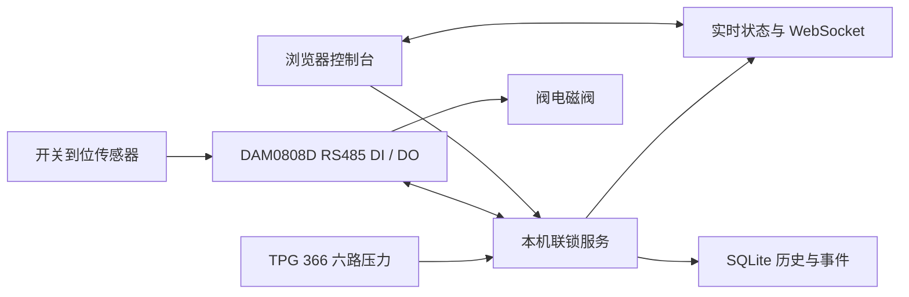

# 真空联锁控制台

用于 TPG 366 真空规控制器与 HTC GVBB-SS-CF63-P 插板阀的本地监控和联锁演示程序。提供实时压力、通道阈值、关阀/人工复位流程、SQLite 历史数据、CSV 导出和事件审计；前端采用暗色液态玻璃面板，布局参考 [beam-stabilizer-live-control](https://github.com/dcysbb/beam-stabilizer-live-control)，玻璃效果为本项目独立实现。

> **运行方式：** 当前采用本机软件联锁：TPG 366 提供压力读数，后台比较软件阈值，DAM 继电器控制电磁阀，并读取阀位传感器。没有外部保护回路；程序、通信或控制器失效时无法保证关阀。实际启用前仍须验证电磁阀断电关阀及阀位反馈，示例阈值不能用于真实设备。

## 快速开始

开发和首次演示需要 Python 3.11+、Node.js 22+ 与 npm。后端默认以模拟模式运行，不会连接真实设备。

在 Windows PowerShell 从仓库目录运行：

```powershell
npm --prefix frontend ci
npm --prefix frontend run build
py -3.12 -m venv backend\.venv
backend\.venv\Scripts\python -m pip install -r backend\requirements.txt
Push-Location backend
.\.venv\Scripts\python run.py
Pop-Location
```

服务启动后访问 <http://127.0.0.1:8770>。本机浏览器打开即可操作，无需设置密码或登录；局域网访问仍使用操作员会话。模拟状态下可以启用联锁、模拟开阀、注入压力超限并验证锁存关阀和人工复位。

运行 `scripts/install-console-shortcut.ps1` 可在桌面和开始菜单创建“真空联锁控制台”快捷方式。右键该快捷方式，选择“显示更多选项 → 固定到任务栏”，以后点击任务栏入口即可自动启动后台并打开页面。后台已运行时直接打开页面，不重复启动，也不会自动启用联锁。

`py -3.12` 创建虚拟环境后，后续启动只需在仓库根目录执行：

```powershell
Push-Location backend
.\.venv\Scripts\python run.py
Pop-Location
```

macOS/Linux 开发环境可在 `backend` 中用 `python3 -m venv .venv`、`.venv/bin/python -m pip install -r requirements.txt` 和 `.venv/bin/python run.py` 启动。前端开发服务器使用 `npm --prefix frontend run dev`，端口 5173 会代理 API 和 WebSocket 到本机后端。

## 配置真实设备

界面的“复位（不启用）”撤销开阀输出、清除故障并返回未启用，不自动启用联锁，不把未知阀位标成关闭。再次启用仍检查有效且新鲜的压力、恢复阈值与稳定时间、关闭到位反馈及断电关阀确认。原 `/api/interlock/reset` 保留“满足恢复条件后复位并启用”的接口语义；故障确认使用 `/api/interlock/clear-fault`。

复位会主动重新打开 I/O 连接，确认开阀输出已关闭并读取当前阀位；连接或读回失败时保留故障。DAM 单次响应超时为 3 秒，不在驱动内重复发送读请求。通信中断后自动关闭、重开串口，并验证 DI 与 DO，最多重连三次；任一次成功就继续监测，三次均失败才锁存故障并要求人工复位。成功通信会重置重连次数。CRC、地址和回显校验仍严格执行，开输出回显丢失时不自动重发。

压力采集与 DAM 通信分别运行，DAM 等待响应不阻塞真空读数和状态推送。重连等待期间阀位显示未确认，禁止新的开阀操作；有效压力超限、真空规离线或数据过期仍触发保护。反馈中断时间不计入阀位动作超时。重连间隔为 1 秒，成功恢复后只继续待执行的关输出，不重发开输出，也不解除已经锁存的压力或设备故障。三次失败后停止自动轮询，人工复位成功后恢复监测且联锁保持未启用。

Windows 上第二次自动重连会先重启配置的 DAM USB 串口设备，再打开串口验证 DI/DO；人工复位在普通连接失败且设备仍存在时也会尝试这一步。使用系统 PnPUtil 按唯一设备实例重启，限定 Ports 类的 USB 串口，排除配置的真空规端口，不重启 USB 集线器或其他设备。需要系统允许设备重启的权限；失败原因写入事件日志。该操作可恢复 USB 驱动卡住的情况，不代表能消除继电器负载造成的电气干扰。Debug 定时关闭在取得状态锁后重新核对当前期限，避免正在开启的输出被临时清理期限误判为到期。

人工复位先重新打开串口并读取 DI/DO，重新插上的设备如果已经正常，不再次重启 USB；普通连接失败且设备仍存在时才执行 USB 恢复。USB 重启成功还需要等待串口连续三次被系统正常识别，不能只凭重启命令返回成功就宣布通信恢复。COM 端口消失时明确提示“未被系统识别”，保持故障和输出清理义务；关闭动作的通信异常返回可读的 409 错误，避免通用 500 错误掩盖原因。Windows 完全没有枚举出 DAM 时，软件不能保证恢复，需要现场核查 USB 线、接口、集线器及供电。

总览的“采样耗时”显示一次读取真空规的实际用时；距上次采样的时间保留为接口的 sample_age_s，用于判断数据是否过期。离线或过期时显示对应状态，历史中将过期读数记为无效，实时曲线也不会重复追加旧样本。历史曲线支持手动纵轴上下限（使用当前压力单位）、可见时间范围自动纵轴、对数/线性刻度、滚轮缩放、拖动平移及悬停查看原始采样时间和各通道读数。

历史曲线中的红色竖线是故障或阀位事件标记，不是压力读数。默认隐藏，需要时勾选“显示事件”；事件日志和历史数据保留。Windows USB 恢复依据：[Microsoft PnPUtil 命令说明](https://learn.microsoft.com/zh-cn/windows-hardware/drivers/devtest/pnputil-command-syntax)。

左侧 Debug 菜单可手动控制 DAM0808D 的 OUT1–OUT8（软件 DO0–DO7），卡片会显示“硬件连接”菜单中定义的端子功能标签。本机直接确认设备可动作后，仅在联锁未启用时允许开启；关闭按钮不要求该确认。默认开启后持续保持，直到手动关闭；可选勾选“定时关闭”，设置 1–60 秒自动关闭时间，也可提前手动关闭。程序停止、解除联锁或修改配置会撤销本次 Debug 输出；存在未关闭调试输出时不能启用联锁。模拟模式显示模拟输出，真实模式读回设备线圈状态。所有切换记录到事件日志。Debug 直接动作继电器，不校验压力许可，通信/程序故障时不能保证输出关闭，仅供停机调试。

历史数据页提供“重置历史”：默认只清除模拟压力记录，真实记录与事件日志保留；也可明确选择清除全部压力记录。重置不受查询时间/通道筛选限制，本机无需登录，仍需确认，操作不可撤销，完成后重新查询图表，后台采集继续。

1. 在“设置”页把运行方式切为“真实设备”；设备连接参数集中在“硬件连接”菜单：TPG 366 可选网口（以太网 TCP）或 USB 串口，DAM0808D 固定为 USB 转 RS485（ADAM6050 旧设备仍走网口），PDXC3 位移台为只读展示，连接配置在位移台页面。
2. 在“硬件连接”菜单填写 TPG 366 的 TCP 或 USB 参数；I/O 控制器默认选择 DAM0808D RS485，填写 USB 转 RS485 的 COM 端口、波特率和现场设备地址。默认 9600、8N1；软件设备地址默认 1，仅为占位值，必须按拨码与地址偏移核实。厂家示例地址 FE（254）也支持，广播地址 0 禁用。
   若使用 USB，连接方式选择“USB 串口”，填写设备管理器中的 COM 端口和控制器一致的波特率（默认 9600，8N1）。Windows 必须安装对应虚拟串口驱动。可点击“仅连接真空规”读取数据；没有 DAM 和保护阈值时仍可监测、保存历史，联锁保持未启用。
3. 只为确定需要保护的 TPG 通道启用保护，并填入实验室批准的关阀压力和较低的恢复压力。界面单位可选 Pa、mbar、Torr，存储值统一为 Pa。任一已启用通道达到关阀值即锁存触发；所有保护通道都低于恢复值并稳定一段时间后，才允许人工复位。
4. 在“硬件连接”菜单的“端子定义与插板阀对应”中选择关闭到位传感器（IN1–IN8）、打开到位传感器（可选）和开阀电磁阀输出（OUT1–OUT8），以及两个传感器的有效电平。软件编号从 0 开始：IN1 对应 DI0，IN5 对应 DI4，OUT1 对应 DO0。两个到位输入不能重复。端子表中的功能标签（每路最多 24 字符）仅用于显示与记录，控制逻辑只由上述对应关系决定。
5. 保存配置，点击“连接设备”。程序读取 TPG 压力、DAM 输入及继电器状态，不写入真空规的继电器阈值。压力保护完全使用已保存的软件阈值。
6. 实际验证电磁阀断电后插板阀关闭、阀位反馈正确后，在真实硬件确认卡片勾选并输入“现场确认”，再手动启用联锁。启用时阀门保持关闭；需要另点“打开插板阀”。不再要求外部压力许可、看门狗、硬件锁存或复位反馈。

### 设备映射

DAM 与 USB 真空规必须使用不同 COM 端口。单击连接只读取 DAM 的输入和继电器状态，不动作继电器。串口响应校验地址、功能码、CRC 和长度；异常或状态读回不符时拒绝继续控制。

已移除外部压力许可 DI、看门狗 DI、硬件锁存 DI、气源 DI、心跳 DO 和硬件复位 DO。正常控制只写入电磁阀输出，Debug 仍可按需控制八路继电器。旧配置中的退役字段读取时忽略，不影响原有串口、阈值、阀位映射和密码。原 ADAM TCP 驱动保留供旧设备选择。

协议依据：[厂家 DAM0808D 串口说明书](https://juyingele.com/download/JY-DAM0808D.pdf)。软件读回的线圈状态只确认控制器内部状态，阀门动作仍须由实际位置传感器验证。

| 设备信号 | 软件默认映射 | 现场要求 |
| --- | --- | --- |
| TPG 366 压力通道 | CH1–CH6，保护通道按配置启用 | TPG 必须输出压力单位；电压单位会被拒绝；状态非正常或样本超时会撤销许可 |
| DAM DI0–DI7 | 关闭到位、打开到位（可选） | 功能码 02，报文地址 0–7；默认关闭 DI0，按实际接线填写打开 DI |
| DAM DO0–DO7 | 默认 DO0 控制电磁阀 | 功能码 01 读取、05 写入；校验回显并读回线圈状态，不输出心跳或硬件复位脉冲 |
| 插板阀位置 | 关闭 DI 必填，打开 DI 可选 | 必须把传感器实际位置与 DAM 输入一一对应；开/关反馈冲突或动作超时会进入故障锁存 |

阀门具体断电状态取决于随货的电磁阀、气路和弹簧复位结构。仅凭 `GVBB-SS-CF63-P + Sensor` 型号描述无法确认现场线圈的失电位置，也不能假定 Sensor 一定提供两路独立行程反馈。

## 运行状态和数据



后端负责采样、阈值比较、联锁状态机、阀门请求输出和事件记录；浏览器只显示状态和提交经身份验证的操作。状态包括“未启用、联锁已启用、联锁已触发、故障停机”。保护触发后阀门保持关阀请求，不自动重开；压力恢复后仍需操作员人工复位，复位后阀门继续关闭。配置变化会撤销运行许可并留下事件记录。

历史页可按时间和通道筛选、查看曲线与最近采样行。页面预览最多返回 100,000 行并显示截断提示；CSV 通过独立只读数据库连接分批导出完整查询范围。数据和事件保存在本机 SQLite；设置 `VACUUM_INTERLOCK_DATA_DIR` 可改变默认数据目录（Windows 默认 `%PROGRAMDATA%\VacuumInterlock`，macOS/Linux 默认 `~/.local/share/vacuum-interlock`）。可在设置页配置历史保留天数，未填写时不自动清理。

## Windows 打包

确认 `frontend/dist` 已由 `npm run build` 生成后，从仓库根目录运行：

```powershell
./scripts/build-windows.ps1
```

脚本会创建 `backend/.venv-build`、安装打包依赖，并生成 `backend/dist/VacuumInterlock/` 与 `backend/dist/VacuumInterlockService/`。普通程序可双击运行；`scripts/open-control-panel.ps1` 会在后台尚未运行时启动普通程序，再打开浏览器。退出后台时会尽力撤销电磁阀输出和本次 Debug 输出。

Windows 服务可由现场管理员在提升权限的终端中执行：

```powershell
backend\dist\VacuumInterlockService\VacuumInterlockService.exe --startup auto install
backend\dist\VacuumInterlockService\VacuumInterlockService.exe start
# 卸载前先停止，避免服务和普通程序同时占用端口。
backend\dist\VacuumInterlockService\VacuumInterlockService.exe stop
backend\dist\VacuumInterlockService\VacuumInterlockService.exe remove
```

服务账户需要对数据目录有写权限。服务日志写入数据目录的 `service.log`，滚动保留三份。`scripts/installer.iss` 可使用 Inno Setup 6 编译为安装包；安装服务选项默认不勾选，勾选后安装服务但不自动开始设备控制。正常使用服务时不要同时启动普通程序。

局域网访问默认关闭。开启后需重启后台；服务会生成本机自签 HTTPS 证书，其他工作站必须先通过受控流程信任该证书。请限制实验室网段访问并定期轮换操作员密码。切勿把设备控制端口直接暴露到互联网。

## 接口与验证

主要接口：`GET /api/status`、`GET /api/config`、`PUT /api/config`、`GET /api/history`、`GET /api/events`、`GET /api/history/export.csv`、`WS /ws/status`。首次密码设置与操作员登录使用 `/api/auth/setup` 和 `/api/auth/login`；本机真实控制操作无需登录，仍校验浏览器 Origin；远程控制需要登录会话。

本机运行测试：

```powershell
backend\.venv\Scripts\python -m pip install -r backend\requirements-dev.txt
Push-Location backend
.\.venv\Scripts\python -m pytest tests -q
Pop-Location
npm --prefix frontend run build
npm --prefix frontend run lint
npm --prefix frontend test
```

TPG366 已通过 COM3 USB 读取 CH4。DAM0808D、阀门及电磁阀尚未完成硬件验收；协议测试使用串口模拟器。软件测试通过不代表真实保护链验证通过。

## 交互与故障恢复

导航和事件栏均可独立展开/收起，状态保存在浏览器；窄屏可使用顶部按钮或导航按钮。后台断连会显示最后一次状态提示，并禁用控制。登录窗口可用关闭按钮、点击遮罩或 Escape 关闭。

界面统一使用中文标题，运行模式只在顶部标识。最近事件默认收起，事件日志页隐藏旁栏；旁栏显示简短事件，完整审计信息在日志详情中展开。模拟故障工具和外观设置折叠显示，USB 连接隐藏 TCP 参数，未启用定时关闭时隐藏时间输入。

模拟模式首次运行将前三路示例阈值保存为可编辑配置，六路均可按设置参与保护。真实模式切换时前端清空示例阈值和现场确认，必须重新填写。模拟支持压力超限、规故障、TPG 中断、I/O 中断、阀位冲突及关阀失败。恢复故障后仍需人工复位，阀门不会自动重开。

存储写入失败会撤销开阀许可并锁存故障；保护循环继续运行，接口显示记录失败。存储恢复并满足压力、阀位等条件后才能复位。配置审计记录旧值/新值；阀到位事件记录从命令到反馈的时间。无打开 Sensor 时不伪造打开到位，只确认已离开关闭位置，关闭到位仍必需。

历史图使用真实时间间隔，支持放大、缩小、平移、恢复完整范围及关键事件标记；显示用降采样保留各通道极值和无效数据断点，CSV 仍导出原始完整范围。日志支持时间、类型、级别筛选、分页及展开详情。超过 1000 个历史事件时图中的标记仅覆盖返回的最近 1000 条。

验收/开发可设置 `VACUUM_INTERLOCK_PORT` 使用独立端口（默认 8770），并搭配 `VACUUM_INTERLOCK_DATA_DIR` 隔离数据库。
